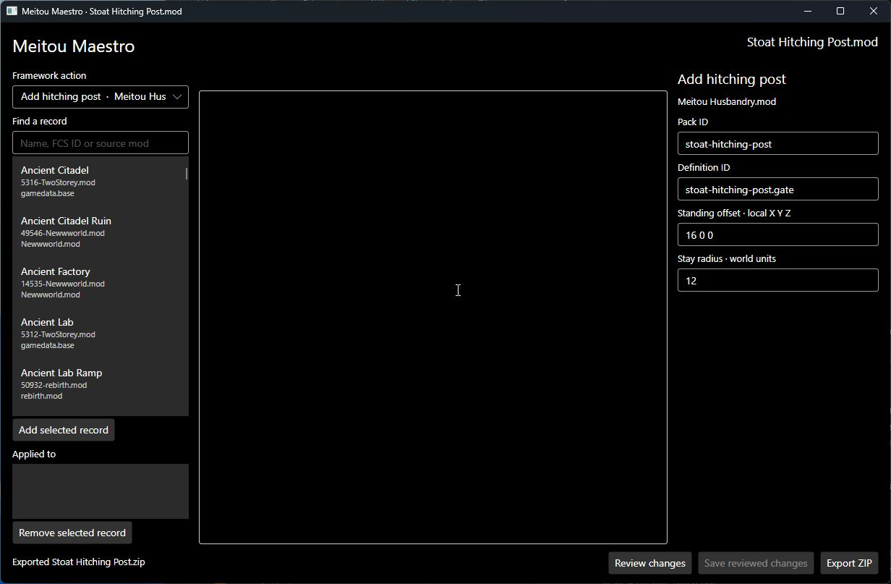

# Make a hitching post for your town

You need an FCS town project with a placed outdoor building, MeitouClient v0.22.1 for playtesting, the [Husbandry framework](https://github.com/mattresspad/MeitouHusbandry/releases/tag/v0.1.0-playtest.2) and [Maestro v0.1.0-playtest.1](https://github.com/mattresspad/MeitouMaestro/releases/tag/v0.1.0-playtest.1). Your players install Husbandry and your town mod. For authoring only, select the v0.20.1 readers required by this released Maestro; the exported data is tested with v0.22.1.

1. **Create and place the building.** In your town mod, give the post its own named `BUILDING` record. Choose a building part with a mesh and collision. Place one instance beside a path, with enough open ground for an adult animal. Save the world edit into your mod’s `leveldata/` folder. The Stoat example references the installed `prisoner_pole_part` record, `18914-small_changes_otto.mod`, for its art and collision. The original building in this example has no prisoner functionality.
2. **Open your town project in Maestro.** Enable Meitou Husbandry in the load order for the Kenshi folder you select. Choose the v0.20.1 reader folder and the writable folder containing your town’s `.mod`. Select **Add hitching post · Meitou Husbandry**. Search for your building by FCS ID, select it and click **Add selected record**.
3. **Fit the stand.** Enter a stable pack ID, such as `my-town`, and a definition ID beginning with that pack ID, such as `my-town.gate`. The offset is in the building’s local X, Y, Z axes, in world units. Turning the post turns its local X/Z offset. Y selects the nearby walkable surface. The radius is the allowed distance around the standing point. The reference offset is **16 0 0**, the radius **12**. Leave space for the animal between the stand and the pole.
4. **Review, save and export.** Check that the review names your own building and adds `Meitou Husbandry.mod`. Click **Save reviewed changes**, then **Export ZIP**. Keep your ZIP outside the editable project. Reapplying the same pack and definition ID updates the entry. Placing another copy of the building gives another animal its own post with the same standing offset and radius.
5. **Try both player orders.** In a fresh profile, enable the framework above your pack and load your town. Select a conscious squad animal within 65 world units of the post. Assign it, order it well outside the radius, allow it to return, then release it during a second return. An obstructed stand can be corrected in your placement or fit. Release and reassign to retry a blocked route.



The [worked project](projects/Stoat%20Hitching%20Post/) exports the following files.

```text
Stoat Hitching Post/
  Stoat Hitching Post.mod
  husbandry.json
  leveldata/zone.39.16.zone
  LICENSE.txt
  NOTICE.txt
```

The `.mod` owns the building and declares the FCS dependency. Its level file owns each physical placement. The [definition](projects/Stoat%20Hitching%20Post/husbandry.json) describes the standing rule. For this example the building ID is `1-Stoat Hitching Post.mod`, and the merged placement key is `39.16:2-Stoat Hitching Post.mod`. Keep placement keys stable when editing an existing town so a saved assignment can find its post.

## Read an assignment from another framework

A dependent code mod can declare `meitou.husbandry` in its Meitou manifest and reference `Meitou.Husbandry.dll` at build time. Meitou supplies that assembly from the loaded framework. Get its entry during initialization and query with the current conversation’s world and animal ID.

```csharp
var husbandry = context.Dependency<IHusbandryApi>("meitou.husbandry")!;
HitchStatus? hitch = husbandry.GetHitch(world, animalId);
```

Both public types are in `Meitou.Husbandry`. A null result means this animal has no assignment in that world. An assigned animal returns `PostKey`, `PostName` and `AtPost` from the last completed Husbandry `SlowWorld` update. This immutable snapshot can lag a command until that update runs. Supply the current world and its character ID, never an ID retained across loading another world. A stablemaster mod can use the key to recognize a particular post and the flag to check whether the Garru is standing there. That mod owns its dialogue. The town and framework work on their own.

[Meitou dependency interface](https://github.com/VlcekM/MeitouClient/blob/v0.22.1/docs/modding-dependencies.md#using-a-dependency) · [Maestro descriptor format](https://github.com/mattresspad/MeitouMaestro/blob/v0.1.0-playtest.1/DESCRIPTORS.md)
