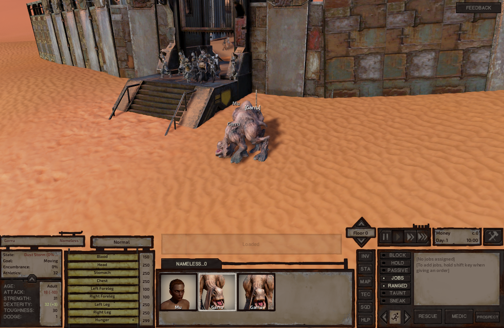

# Observed playtest results

**Passed: Meitou Husbandry 0.1.0-playtest.2 on packaged MeitouClient v0.22.1, Windows x64.** Game commit `9ee4074bbc6fd7fdeb26108a04afc9f90cb1dc01`, mod API 2; .NET SDK 11.0.100. All 260 installed game-package files matched the official archive. [Environment and archive digests](evidence/v0.22.1/environment.json).

[Watch the hitching sequence](evidence/v0.22.1/stoat-hitch.mp4) · [Installed-file and save audit](evidence/v0.22.1/audit.json) · [Simulation output](evidence/v0.22.1/simulation.txt).

| Check | Observed result |
| --- | --- |
| Framework alone | Zero post instances and zero hitching actions. |
| Two-mod example | One post outside Stoat; one owned Garru assigned. Repeat assignment confirmed it; the same-record sibling was refused. |
| Player control | The handler walked away; the Garru remained assigned. A direct outward order took priority, then the idle animal returned without another order. |
| Persistence | Saving kept the assignment. Reload restored portrait serial 2266246144 and its native save handle to the same placed post; sibling 2364758784 stayed free. |
| Release and revisit | Release during the return freed the post and allowed ordinary movement away. After a QA travel excursion of about 3,850 units, the same post accepted the sibling. |
| Two copies of one building | Distinct placed-building keys held distinct Garru. Releasing one did not evict the other. |
| Simulation | 1,623 matching tick hashes with one and four workers; final hash `d3f5c8efc6a90dcf`. |
| Authoring | Released Windows Maestro 0.1.0-playtest.1 discovered the framework descriptor, reviewed and saved the post, reopened it and exported all five sample files. |
| Reproducibility | Both ZIPs matched across the publication checkout, a fresh clone and a source-archive build without Git metadata. Embedded debug data contains no absolute drive paths. |

The simulation separately verifies unowned/human rejection, blocked standing points, disconnected and obstructed routes, no repeated path requests after failure, release preserving a direct order, priority of jobs and combat, ambiguous identity refusal, and independent world queries. These are simulated checks; the live run uses native town streaming, pathfinding, F10 actions and saves.

[Single-post trace](evidence/v0.22.1/stoat-trace.txt) · [Two-post trace](evidence/v0.22.1/two-post-trace.txt) · [Two occupied posts](evidence/v0.22.1/two-posts.png) · [Maestro export](evidence/v0.22.1/maestro-export.png) · [Reproducibility](evidence/v0.22.1/reproducibility.json).

## Limits and test conditions

This is a hitching rule, with no rope or tether animation. Live validation covers Garru in a Windows x64 town fixture. Native Linux gameplay and other animal types are not claimed as tested here. The leave/revisit check uses a QA teleport for travel; the framework never teleports the assigned animal.

The first observer run paused at a stock gate inspection awaiting a player reply. The updated QA observer uses the normal accept-inspection and [Leave] dialogue commands; it does not suppress dialogue or force the world to unpause. The framework needed no gameplay changes from its v0.20.1 prototype.

Maestro uses v0.20.1 readers for authoring. Its exported payload is byte-identical to the five files installed for the v0.22.1 test. Release ZIP timestamps are normalized, so the raw editor ZIP has a different archive hash. The video is assembled from native captured frames and cuts across save/reload; it is not a frame-time benchmark. The native live observer is a separate QA-only DLL, absent from both player ZIPs.

[Historical v0.20.1 evidence](evidence/historical-v0.20.1/RESULTS.md) remains labeled separately; the original local kit was left intact.
